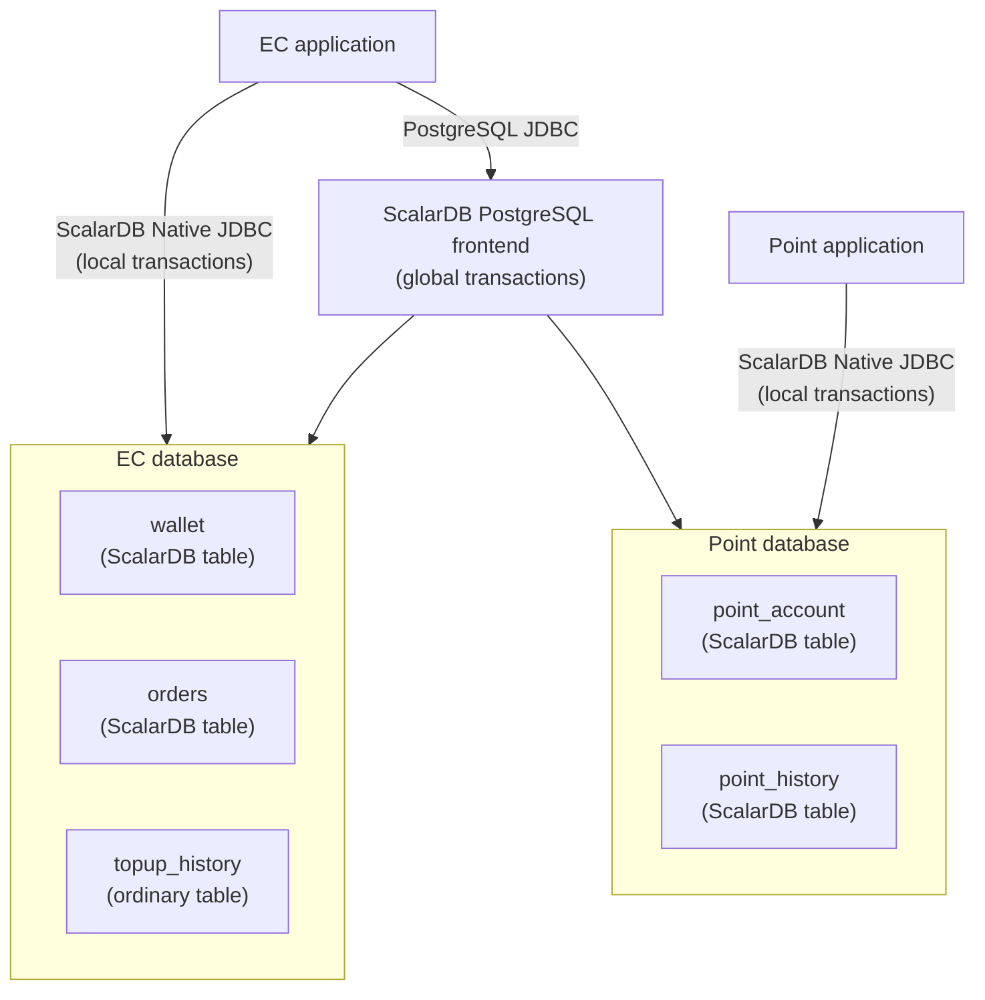

# Getting started with ScalarDB Native JDBC

This guide takes two existing applications, each with its own database, and integrates them with
ScalarDB without merging them. Both keep their SQL and their databases' own transactions through
ScalarDB Native JDBC. Then one of them adds a transaction across both databases, in SQL too.

## The scenario

Two systems grew up separately, each with its own team, database and application:

- The **EC system** sells items. Customers top up a prepaid wallet and pay from it. Its database
  holds `wallet`, each customer's balance; `orders`; and `topup_history`, a record of each top-up.
- The **point system** runs a loyalty program. Customers earn points, for example by checking in.
  Its database holds `point_account`, each customer's points, and `point_history`, every change to
  them.

The business wants customers to **pay with points at checkout**: part of the price in points, the
rest from the wallet. Taking points off `point_account` and money off `wallet` must happen
together or not at all, but they are in two databases owned by two teams.

ScalarDB runs transactions across databases. It does that on tables it manages, which keep
ScalarDB's transaction metadata for each row. So the integration goes in two phases:

1. **Adopt, without changing the applications.** Make the tables a cross-database transaction will
   touch ScalarDB tables. Both applications then reach their databases through ScalarDB Native
   JDBC: they change only their JDBC URLs, and keep their SQL and their local transactions. Through
   the database's own JDBC driver, their SQL would read data ScalarDB transactions have not
   committed, and write rows without the metadata ScalarDB transactions check.
2. **Integrate.** The EC application adds "pay with points" as one global transaction across both
   databases. It runs it through ScalarDB's PostgreSQL frontend, which takes SQL over the PostgreSQL
   protocol and runs it as a ScalarDB transaction. So the EC application uses plain JDBC and SQL for
   both kinds of transaction: only the URL tells local from global.



A table becomes a ScalarDB table only if a global transaction touches it. "Pay with points" writes
`wallet`, `orders`, `point_account` and `point_history`. `topup_history` is written only by the EC
application's local top-up, so it stays an ordinary table. The point system keeps its database and
its application; the EC application reaches the point database only through ScalarDB.

You will:

1. start the two databases;
2. make the four shared tables ScalarDB tables;
3. set both databases up for the driver;
4. query them with `snsql`, the driver's interactive shell;
5. run both applications as before, through the driver;
6. start the PostgreSQL frontend and pay with points;
7. see a local and a global transaction meet on the same row.

The guide uses PostgreSQL for both databases. The steps are the same on MySQL, MariaDB, SQL Server
and Oracle, and the two databases can be different engines; only the URLs, the DDL and the vendor
driver change ([Other databases](#other-databases)). Steps 1 to 5 use the driver alone: if you only
want local transactions, you can stop after step 5. If a step fails with an error,
[Troubleshooting a first run](../README.md#troubleshooting-a-first-run) has the usual causes.

## What you need

- Java 17 or later on your `PATH` or in `JAVA_HOME`, which Gradle 9 needs to build the example.
  The example and the driver themselves run on Java 11 or later.
- Docker, for the two databases and the PostgreSQL frontend. Step 6 pulls the frontend's image,
  `ghcr.io/scalar-labs/scalardb-postgres-frontend:3.20.1`.
- This repository's [`samples/getting-started`](../samples/getting-started) directory. It holds every
  file the guide uses, so you don't copy any from this page.
- From the [ScalarDB releases](https://github.com/scalar-labs/scalardb/releases), ScalarDB 3.20's
  Schema Loader, `scalardb-schema-loader-3.20.0.jar`, about 170 MB. Download `scalardb-schema-loader`, not
  `scalardb-cluster-schema-loader`, which is for ScalarDB Cluster. Put it in
  `samples/getting-started`.
- From the latest of the [ScalarDB Native JDBC releases](https://github.com/scalar-labs/scalardb-native-jdbc/releases),
  `scalardb-native-shell-<VERSION>.zip` (`snsql`) and `scalardb-native-tools-<VERSION>.zip`
  (`scalardb-native-tools`), where `<VERSION>` is the release's version. Unzip both and put their `bin`
  directories on your `PATH`. Both bundle the JDBC drivers of PostgreSQL, MariaDB (also used for
  MySQL), SQL Server and Oracle.

You do not build the driver: the example gets the latest release from Maven Central as
`com.scalar-labs:scalardb-native-jdbc`.

Run every command in this guide from `samples/getting-started`:

```sh
cd samples/getting-started
```

## 1. Start the two databases

Create a Docker network, so that the frontend in step 6 can reach both databases by name, and start
the EC database on port 5432 and the point database on port 5433:

```sh
docker network create native-net
docker run -d --name native-ec --network native-net -p 5432:5432 \
  -e POSTGRES_PASSWORD=postgres -e POSTGRES_INITDB_ARGS="--locale=C --encoding=UTF8" postgres:17
docker run -d --name native-point --network native-net -p 5433:5432 \
  -e POSTGRES_PASSWORD=postgres -e POSTGRES_INITDB_ARGS="--locale=C --encoding=UTF8" postgres:17
```

The `C` locale makes PostgreSQL compare text in byte order, as ScalarDB does, so a query that sorts
or ranges over text returns the same rows through ScalarDB as through PostgreSQL.

Wait until both accept connections, a few seconds after the containers start:

```sh
until docker exec native-ec pg_isready -U postgres -h localhost; do sleep 1; done
until docker exec native-point pg_isready -U postgres -h localhost; do sleep 1; done
```

```text
localhost:5432 - accepting connections
localhost:5432 - accepting connections
```

Both lines say 5432: each check runs inside its own container.

Create the two systems' tables and data, as they were before ScalarDB came in. `ec.sql` and
`point.sql` hold the DDL and one customer, with 10,000 in the wallet and 500 points:

```sh
docker exec -i native-ec psql -U postgres < ec.sql
docker exec -i native-point psql -U postgres < point.sql
```

```sql
-- ec.sql
CREATE SCHEMA ec;
CREATE TABLE ec.wallet (
  customer_id INT PRIMARY KEY,
  balance INT NOT NULL
);
CREATE TABLE ec.orders (
  order_id VARCHAR(36) PRIMARY KEY,
  customer_id INT NOT NULL,
  item VARCHAR(50) NOT NULL,
  price INT NOT NULL,
  paid_money INT NOT NULL,
  paid_points INT NOT NULL
);
CREATE TABLE ec.topup_history (
  topup_id BIGINT GENERATED ALWAYS AS IDENTITY PRIMARY KEY,
  customer_id INT NOT NULL,
  amount INT NOT NULL,
  topped_up_at TIMESTAMPTZ NOT NULL DEFAULT now()
);
INSERT INTO ec.wallet VALUES (1, 10000);

-- point.sql
CREATE SCHEMA point;
CREATE TABLE point.point_account (
  customer_id INT PRIMARY KEY,
  points INT NOT NULL
);
CREATE TABLE point.point_history (
  history_id VARCHAR(36) PRIMARY KEY,
  customer_id INT NOT NULL,
  delta INT NOT NULL,
  reason VARCHAR(100) NOT NULL
);
INSERT INTO point.point_account VALUES (1, 500);
```

## 2. Make the shared tables ScalarDB tables

Import the four tables into ScalarDB with the Schema Loader. The import keeps the tables and their
rows, and adds ScalarDB's metadata columns to each table, the inline
[layout](concepts.md#layout). [Setting up tables](setting-up-tables.md#making-a-table-scalardbs) has
the other ways: creating a table with the Schema Loader, and the decoupled layout, which keeps the
metadata in a separate table.

Each database has its own Schema Loader configuration. `ec.properties` names the EC database, and
`point.properties` the point database on port 5433:

```properties
scalar.db.storage=jdbc
scalar.db.contact_points=jdbc:postgresql://localhost:5432/postgres
scalar.db.username=postgres
scalar.db.password=postgres
```

`import-ec.json` and `import-point.json` list the tables to import:

```json
{
  "ec.wallet": {
    "transaction": true
  },
  "ec.orders": {
    "transaction": true
  }
}
```

```json
{
  "point.point_account": {
    "transaction": true
  },
  "point.point_history": {
    "transaction": true
  }
}
```

Import them, and create ScalarDB's Coordinator table, which records the outcome of each global
transaction, in the EC database, since the EC application starts the global transactions:

```sh
java -jar scalardb-schema-loader-3.20.0.jar --config ec.properties -f import-ec.json --import
java -jar scalardb-schema-loader-3.20.0.jar --config ec.properties --coordinator
java -jar scalardb-schema-loader-3.20.0.jar --config point.properties -f import-point.json --import
```

The Coordinator table needs a run of its own: the Schema Loader refuses `--coordinator` together with
`--import`. Among its log lines, `Data type larger than that of underlying database is assigned:
ec.orders order_id (varchar to TEXT)` and the like are expected: ScalarDB reads `VARCHAR(n)` as its
`TEXT` type, and the column stays as it is. `Schema path: null` from the `--coordinator` run is
expected too, since that run takes no schema file.

`topup_history` is not imported: no global transaction touches it.

### Isolation

ScalarDB's transactions run at `scalar.db.consensus_commit.isolation_level`, set in the
configuration of everything that runs them, here the frontend's in step 6. It must be the level the
driver's connections use, since a weaker level on either side breaks what the other side's level
protects. This guide leaves it at ScalarDB's default, SNAPSHOT, and runs `snsql` and the
applications at SNAPSHOT too, which JDBC calls `REPEATABLE_READ`. For the other levels, and the
setting of ScalarDB's own connections to the database (`scalar.db.jdbc.isolation_level`), see
[Isolation levels](transactions.md#isolation-levels).

### Once the tables are ScalarDB's

From now on, read and write the four tables through the driver or the frontend only: with `snsql`
or the applications, not `psql`, which bypasses them as [the scenario](#the-scenario) explains.
`psql` stays right for DDL and for ordinary tables such as `topup_history`.

## 3. Set both databases up for the driver

Before the driver serves a ScalarDB table, run [the setup](concepts.md#the-setup) once on its
database, as a user that can run DDL. It creates each table's [in-flight
index](concepts.md#in-flight-index) and [read view](concepts.md#read-view), which the driver needs to
read the table safely. The setup is safe to run again, and you run it again whenever a table is
added to ScalarDB. The tools read the password from `SCALARDB_NATIVE_PASSWORD`, and `snsql`, in
step 4, from `SNSQL_PASSWORD`, since the setup is often run as a different user from the
application's.

```sh
export SCALARDB_NATIVE_PASSWORD=postgres
scalardb-native-tools setup jdbc:scalardb-native:postgresql://localhost:5432/postgres -U postgres --no-wait
scalardb-native-tools setup jdbc:scalardb-native:postgresql://localhost:5433/postgres -U postgres --no-wait
```

```text
ec.orders: created in-flight index orders_inflight, backfill skipped (--backfill runs it), created read view rc_orders, analyzed orders
ec.wallet: created in-flight index wallet_inflight, backfill skipped (--backfill runs it), created read view rc_wallet, analyzed wallet

New ScalarDB tables: ec.orders, ec.wallet.
ScalarDB transactions may write ec.orders, ec.wallet from <date> <time>, or after every application using the driver on this database has restarted.
point.point_account: created in-flight index point_account_inflight, backfill skipped (--backfill runs it), created read view rc_point_account, analyzed point_account
point.point_history: created in-flight index point_history_inflight, backfill skipped (--backfill runs it), created read view rc_point_history, analyzed point_history

New ScalarDB tables: point.point_account, point.point_history.
ScalarDB transactions may write point.point_account, point.point_history from <date> <time>, or after every application using the driver on this database has restarted.
```

`<date> <time>` is 60 seconds after the run. Without `--no-wait`, the setup waits until then before
it returns. The wait is for ScalarDB transactions, not for the driver. The driver keeps a list of
ScalarDB tables, its [catalog](concepts.md#catalog), and reads it again every 60 seconds. An
application that was already running before the setup has the list from before, and may treat a new
table as an ordinary table for up to 60 seconds. So once applications using the driver run, start
ScalarDB transactions on a new table only after that time
([Adding a table to ScalarDB while applications run](setting-up-tables.md#adding-a-table-to-scalardb-while-applications-run)).
In this guide nothing is running yet, and `snsql` and the applications load the list when they
start: `--no-wait` is safe, and you can go on straight away.

### When to run the backfill

`backfill skipped` is expected. The driver doesn't need the backfill: it reads a row without
transaction metadata, such as the rows the tables held before the import, as committed, and gives
the row its metadata when it first writes it. ScalarDB can need it on an imported table in the
decoupled layout, never in the inline layout of this guide
([Setting up tables](setting-up-tables.md#backfill)).

Check the result:

```sh
scalardb-native-tools check jdbc:scalardb-native:postgresql://localhost:5432/postgres -U postgres
scalardb-native-tools check jdbc:scalardb-native:postgresql://localhost:5433/postgres -U postgres
```

```text
ec.orders: set up, no rows stuck
ec.wallet: set up, no rows stuck
point.point_account: set up, no rows stuck
point.point_history: set up, no rows stuck
```

`check` exits with 0 when every ScalarDB table is set up.

## 4. Query with snsql

`snsql` is a psql-like shell that goes through the driver. Open the EC database:

```sh
export SNSQL_PASSWORD=postgres
snsql -U postgres jdbc:scalardb-native:postgresql://localhost:5432/postgres
```

List the tables. The `ScalarDB` column marks the imported ones:

```text
postgres=> \dt ec.*
             List of relations
 Schema |     Name      | Type  | ScalarDB
--------+---------------+-------+----------
 ec     | orders        | table | yes
 ec     | topup_history | table |
 ec     | wallet        | table | yes
(3 rows)

postgres=> SELECT * FROM ec.wallet;
 customer_id | balance
-------------+---------
           1 |   10000
(1 row)

postgres=> \q
```

`SELECT *` returns `customer_id` and `balance` only, without ScalarDB's metadata columns. The
session runs at SNAPSHOT: a driver connection starts at SNAPSHOT, ScalarDB's default level.
`BEGIN`, `COMMIT` and `ROLLBACK` work as in psql, and `\?` lists the other commands.

To run one statement and exit, here on the point database:

```sh
snsql -U postgres jdbc:scalardb-native:postgresql://localhost:5433/postgres \
  -c "SELECT * FROM point.point_account"
```

```text
 customer_id | points
-------------+--------
           1 |    500
(1 row)
```

## 5. Run the applications as before

The two applications are one Gradle project in `samples/getting-started`, with a task for each:
`./gradlew -q ec` runs the EC application, `./gradlew -q point` the point application. Its
`build.gradle.kts` adds the driver and PostgreSQL's own JDBC driver; the driver brings its other
dependencies, JSQLParser and SLF4J's API, with it:

```kotlin
dependencies {
    implementation("com.scalar-labs:scalardb-native-jdbc:<VERSION>")
    runtimeOnly("org.postgresql:postgresql:42.7.14")
    runtimeOnly("org.slf4j:slf4j-simple:2.0.20")
}
```

With Maven, the same dependencies are:

```xml
<dependency>
  <groupId>com.scalar-labs</groupId>
  <artifactId>scalardb-native-jdbc</artifactId>
  <version><VERSION></version>
</dependency>
<dependency>
  <groupId>org.postgresql</groupId>
  <artifactId>postgresql</artifactId>
  <version>42.7.14</version>
  <scope>runtime</scope>
</dependency>
<dependency>
  <groupId>org.slf4j</groupId>
  <artifactId>slf4j-simple</artifactId>
  <version>2.0.20</version>
  <scope>runtime</scope>
</dependency>
```

`slf4j-simple` prints the driver's log, warnings included; any SLF4J 2 binding will do.

The applications are plain JDBC. The only changes from applications written for PostgreSQL alone
are the URL, `jdbc:scalardb-native:postgresql:...` in place of `jdbc:postgresql:...`, and the
isolation level, set to SNAPSHOT as in step 4. In
`src/main/java/example/EcApp.java`, the top-up adds to the wallet and records the top-up in one
local transaction:

```java
  private static final String LOCAL = "jdbc:scalardb-native:postgresql://localhost:5432/postgres";

  private static Connection local() throws SQLException {
    Connection c = DriverManager.getConnection(LOCAL, "postgres", "postgres");
    // SNAPSHOT, the level of ScalarDB's transactions (ScalarDB's default)
    c.setTransactionIsolation(Connection.TRANSACTION_REPEATABLE_READ);
    return c;
  }

  /** A local transaction: the wallet and its ordinary history table. */
  static void topUp(Connection c, int customer, int amount) throws SQLException {
    updateOne(c, "UPDATE ec.wallet SET balance = balance + ? WHERE customer_id = ?", amount, customer);
    update(c, "INSERT INTO ec.topup_history (customer_id, amount) VALUES (?, ?)", customer, amount);
  }
```

`wallet` is a ScalarDB table and `topup_history` an ordinary one. Through the driver, a statement on
an ordinary table runs as written, and the transaction is the database's own, so both commit or
roll back together.

`src/main/java/example/Transactions.java` runs each unit of work as one transaction, and retries it
when it fails with SQLState `40001`, a conflict with another transaction, a ScalarDB transaction
included:

```java
  static void run(Connection c, Work work) throws SQLException {
    for (int attempt = 1; ; attempt++) {
      c.setAutoCommit(false);
      try {
        work.run(c);
        c.commit();
        return;
      } catch (SQLException e) {
        c.rollback();
        // 40001: a conflict with another transaction, local or global; retry
        if (!"40001".equals(e.getSQLState()) || attempt == 3) {
          throw e;
        }
      } finally {
        c.setAutoCommit(true);
      }
    }
  }
```

Top up 3,000 and buy a 500 pen from the wallet, each a local transaction on the EC database:

```sh
./gradlew -q ec --args="topup 1 3000"
./gradlew -q ec --args="buy 1 pen 500"
```

```text
wallet of customer 1: 13000
wallet of customer 1: 12500
```

The point application, `src/main/java/example/PointApp.java`, earns points the same way, in a local
transaction on the point database that adds to `point_account` and records the change in
`point_history`:

```sh
./gradlew -q point --args="earn 1 100 checkin"
```

```text
points of customer 1: 600
```

## 6. Pay with points

### Start the PostgreSQL frontend

The frontend is a ScalarDB that speaks the PostgreSQL protocol. Its configuration,
`frontend.properties`, is ScalarDB's [multi-storage
configuration](https://scalardb.scalar-labs.com/docs/latest/multi-storage-transactions/): one
ScalarDB over both databases, each namespace mapped to its database, and the Coordinator table in the
EC database. It runs in a container on `native-net`, so it names the database containers:

```properties
scalar.db.storage=multi-storage
scalar.db.multi_storage.storages=ec,point
scalar.db.multi_storage.storages.ec.storage=jdbc
scalar.db.multi_storage.storages.ec.contact_points=jdbc:postgresql://native-ec:5432/postgres
scalar.db.multi_storage.storages.ec.username=postgres
scalar.db.multi_storage.storages.ec.password=postgres
scalar.db.multi_storage.storages.point.storage=jdbc
scalar.db.multi_storage.storages.point.contact_points=jdbc:postgresql://native-point:5432/postgres
scalar.db.multi_storage.storages.point.username=postgres
scalar.db.multi_storage.storages.point.password=postgres
scalar.db.multi_storage.namespace_mapping=ec:ec,point:point,coordinator:ec
scalar.db.multi_storage.default_storage=ec
```

Start it on port 15432:

```sh
docker run -d --name native-frontend --network native-net -p 127.0.0.1:15432:5432 \
  -v "$PWD/frontend.properties:/scalardb-postgres-frontend/scalardb.properties:ro" \
  ghcr.io/scalar-labs/scalardb-postgres-frontend:3.20.1
until docker logs native-frontend 2>&1 | grep -q Listening; do sleep 1; done
```

Run this way, on ScalarDB alone, the frontend has no authentication: anyone who can reach its port
has full access, and it logs a warning that says so. `-p 127.0.0.1:15432:5432` keeps the port on your
machine. In production the frontend runs inside each ScalarDB Cluster node, with Cluster's
authentication.

### The global transaction

The EC application's new purchase connects to the frontend with PostgreSQL's own JDBC driver. The
database name in the URL, `ec`, is a ScalarDB namespace; tables in the other namespace are named with
it, as in `point.point_account`, and every statement here names its namespace anyway:

```java
  private static final String GLOBAL = "jdbc:postgresql://localhost:15432/ec";

  /** A local transaction: pay the whole price from the wallet. */
  static void buy(Connection c, int customer, String item, int price) throws SQLException {
    payMoney(c, customer, price);
    insertOrder(c, customer, item, price, price, 0);
  }

  /** A global transaction: pay part of the price with points, the rest from the wallet. */
  static void buyWithPoints(Connection c, int customer, String item, int price, int points)
      throws SQLException {
    String orderId = insertOrder(c, customer, item, price, price - points, points);
    payPoints(c, customer, points, orderId);
    payMoney(c, customer, price - points);
  }
```

`buy`, the local purchase of step 5, and `buyWithPoints` share `payMoney` and `insertOrder`, the same
SQL on `ec.wallet` and `ec.orders`, and the same `Transactions.run` with its retry. `payPoints` checks
the points, takes them off `point.point_account` and records the change in `point.point_history`.
Only the connection differs. The frontend runs every transaction at the level its configuration
sets, SNAPSHOT here, so the application doesn't set one; asking for a stronger level fails with
`0A000`.

Buy a 1,500 book with 400 points and the rest from the wallet:

```sh
./gradlew -q ec --args="buy-with-points 1 book 1500 400"
```

```text
wallet of customer 1: 11400
points of customer 1: 200
```

The wallet went from 12,500 to 11,400 and the points from 600 to 200, in one transaction across the
two databases. Look at both sides with `snsql`:

```sh
snsql -U postgres jdbc:scalardb-native:postgresql://localhost:5432/postgres \
  -c "SELECT item, price, paid_money, paid_points FROM ec.orders ORDER BY paid_points"
snsql -U postgres jdbc:scalardb-native:postgresql://localhost:5433/postgres \
  -c "SELECT delta, reason FROM point.point_history ORDER BY delta"
```

```text
 item | price | paid_money | paid_points
------+-------+------------+-------------
 pen  |   500 |        500 |           0
 book |  1500 |       1100 |         400
(2 rows)

 delta |                   reason
-------+--------------------------------------------
  -400 | order bf15eac3-8ee8-4739-89f8-fed6c42b1fc0
   100 | checkin
(2 rows)
```

Now try to pay 900 points, more than the customer has:

```sh
./gradlew -q ec --args="buy-with-points 1 book 1500 900"
```

```text
rolled back: not enough points: 200 < 900
```

`buyWithPoints` had already inserted the order when `payPoints` found too few points. The transaction
rolled back, so neither database changed: `ec.orders` still has two orders, the wallet 11,400 and
the points 200.

## 7. A local and a global transaction on the same row

The point application keeps earning points through the driver while the EC application spends them
in global transactions through the frontend, on the same `point_account` row. Neither overwrites the
other. To see it, use two terminals.

In the first, open `psql` on the frontend, from inside the EC database's container, and start a
purchase: a global transaction that reads the wallet and the points:

```sh
docker exec -it native-ec psql -h native-frontend -U postgres -d ec
```

```text
ec=> BEGIN;
BEGIN
ec=*> SELECT balance FROM ec.wallet WHERE customer_id = 1;
 balance
---------
   11400
(1 row)

ec=*> SELECT points FROM point.point_account WHERE customer_id = 1;
 points
--------
    200
(1 row)
```

In the second, from `samples/getting-started`, the point application earns 10 points, a local
transaction on the point database:

```sh
./gradlew -q point --args="earn 1 10 checkin"
```

```text
points of customer 1: 210
```

Back in the first, finish the purchase, a 300 cup paid with 100 points and 200 from the wallet, and
commit:

```text
ec=*> INSERT INTO ec.orders VALUES ('cup-1', 1, 'cup', 300, 200, 100);
INSERT 0 1
ec=*> UPDATE point.point_account SET points = points - 100 WHERE customer_id = 1;
UPDATE 1
ec=*> INSERT INTO point.point_history VALUES ('cup-1-points', 1, -100, 'order cup-1');
INSERT 0 1
ec=*> UPDATE ec.wallet SET balance = balance - 200 WHERE customer_id = 1;
UPDATE 1
ec=*> COMMIT;
ERROR:  DB-CORE-20013: A conflict occurred. ...
ec=> SELECT balance FROM ec.wallet WHERE customer_id = 1;
 balance
---------
   11400
(1 row)

ec=> SELECT points FROM point.point_account WHERE customer_id = 1;
 points
--------
    210
(1 row)
```

The purchase read 200 points before the earn committed 210. Committing would have written 100 and
lost the 10 points just earned, so ScalarDB refused the whole transaction with SQLState `40001`: the
earn is kept, and neither database has the purchase, not the order, the wallet change or the points
change. An application retries such a transaction, as `Transactions.run` does. Run the same
statements again, from `BEGIN`, and the purchase reads 210 and commits: the wallet 11,200, the
points 110. Quit with `\q`.

It works the other way round too: a local transaction through the driver that conflicts with a
global one fails with `40001`.

## Start over and clean up

Remove the containers and the network, and with them everything the guide created:

```sh
docker rm -f native-frontend native-ec native-point
docker network rm native-net
```

## Other databases

[Connection URLs](configuration.md#connection-urls) has each database's driver URL and vendor
driver. `scalar.db.contact_points` in the Schema Loader's and the frontend's configurations is the
vendor URL. The two databases can be different engines: the frontend's configuration gives each
storage its own. Some details differ from PostgreSQL:

- **MySQL and MariaDB.** A namespace is a database, so `CREATE DATABASE ec`. On MySQL an `INSERT`
  has no `RETURNING`; MariaDB has it.
- **SQL Server.** The database needs `READ_COMMITTED_SNAPSHOT ON`, and `ALLOW_SNAPSHOT_ISOLATION ON`
  for `TRANSACTION_REPEATABLE_READ` and `TRANSACTION_SERIALIZABLE`; sessions need `XACT_ABORT` off
  ([Database settings](configuration.md#database-settings-the-driver-needs)).
  `scalardb-native-tools check` reports them. A key the database generates in a ScalarDB table comes
  from a sequence default, not `IDENTITY`, which ScalarDB cannot write.
- **Oracle.** A table created with Oracle's own DDL and unquoted names has upper-case names, and
  ScalarDB's API uses them so. ScalarDB imports `NUMBER` columns as `BIGINT`.
  `TRANSACTION_SERIALIZABLE` is not available, and ScalarDB's own connections take
  `scalar.db.jdbc.isolation_level=READ_COMMITTED` for inline tables
  ([ScalarDB's connections on Oracle](transactions.md#scalardbs-connections-on-oracle)).

On every engine, set the databases to compare text in byte order, as the `C` locale does on
PostgreSQL in step 1. [SQL support](sql-support.md) and
[Transactions and isolation levels](transactions.md) have the full list.

## Next steps

- [Transactions and isolation levels](transactions.md): READ COMMITTED, SNAPSHOT and SERIALIZABLE, and
  the ScalarDB settings each needs.
- [SQL support](sql-support.md): what the driver supports and refuses (`0AN01`).
- [Setting up tables](setting-up-tables.md): the other ways to make a table ScalarDB's, the setup
  and its check in full, and adding a table while applications run.
- [Configuration](configuration.md), [Errors](errors.md) and [snsql](snsql.md).
- `samples/crud-jdbc`, `samples/crud-spring-data-jdbc` and `samples/crud-jpa`: a connection pool,
  Spring Data JDBC, and Spring Data JPA with Hibernate.
- The [ScalarDB PostgreSQL frontend](https://github.com/scalar-labs/scalardb-postgres-frontend)'s
  documentation, for its SQL and for running it in ScalarDB Cluster.
- [docs/design.md](design.md): how the driver works.
