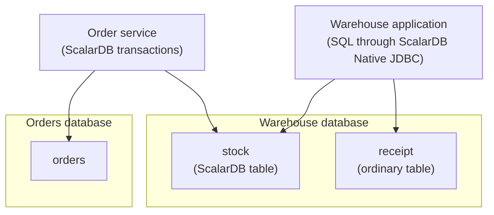

# Getting started with ScalarDB Native JDBC

This guide takes you from an empty database to a Java program that reads and writes a ScalarDB table
through ScalarDB Native JDBC, in plain SQL and the database's own transactions.

## The scenario

A company keeps its data in two databases:

- the **orders database** holds `orders`, the orders customers place;
- the **warehouse database** holds `stock`, how many of each item the warehouse has, and `receipt`,
  a record of each delivery the warehouse receives.

Two applications use them:

- The **order service** places an order. In one transaction it adds the order to `orders` and takes
  the ordered quantity off `stock`: one transaction across two databases. It runs that transaction
  with ScalarDB.
- The **warehouse application** receives deliveries. In one transaction it adds the delivered
  quantity to `stock` and records the delivery in `receipt`. It was written in SQL against the
  warehouse database long before ScalarDB came in.



ScalarDB transactions work on tables ScalarDB manages, which keep ScalarDB's transaction metadata
for each row. So `orders` and `stock`, which the order service writes, are ScalarDB tables.
`receipt`, which only the warehouse application uses, stays an ordinary table.

That leaves the warehouse application in a bind. Through the database's own JDBC driver, its SQL on
`stock` would read data ScalarDB transactions have not committed, and would write rows without the
metadata ScalarDB transactions check. ScalarDB Native JDBC solves this: the warehouse application
keeps its SQL and its transactions across `stock` and `receipt`, and changes only its JDBC URL. The
driver keeps those transactions and the order service's ScalarDB transactions on the same rows
consistent with each other.

This guide sets up the warehouse database and the warehouse application. The order service and the
orders database are ScalarDB as usual, and not part of the guide. You will:

1. start the warehouse database;
2. make `stock` a ScalarDB table;
3. set it up for the driver;
4. query it with `snsql`, the driver's interactive shell;
5. run the warehouse application's program, which receives a delivery into `stock`;
6. optionally, add `receipt` to the program's transaction.

The guide uses PostgreSQL. The steps are the same on MySQL, MariaDB, SQL Server and Oracle; only the
URLs, the DDL and the vendor driver change ([Other databases](#other-databases)).

## What you need

- Java 17 or later on your `PATH` or in `JAVA_HOME`, for the example's Gradle build. The driver
  itself needs Java 11 or later.
- Docker, for the database in this guide. Any PostgreSQL you can create tables in will do.
- This repository's [`samples/getting-started`](../samples/getting-started) directory. It holds every
  file the guide uses, so you don't copy any from this page.
- From the [ScalarDB releases](https://github.com/scalar-labs/scalardb/releases), the Schema Loader
  of the ScalarDB line the driver is certified against, `scalardb-schema-loader-<SCALARDB_VERSION>.jar`
  ([Compatibility](../README.md#compatibility)), about 170 MB. Take `scalardb-schema-loader`, not
  `scalardb-cluster-schema-loader`, which is for ScalarDB Cluster. Put it in
  `samples/getting-started`.
- From the ScalarDB Native JDBC GitHub release, `scalardb-native-shell-<VERSION>.zip` (`snsql`) and
  `scalardb-native-tools-<VERSION>.zip` (`scalardb-native-tools`). Unzip both and put their `bin`
  directories on your `PATH`. Both bundle the JDBC drivers of PostgreSQL, MariaDB (also used for
  MySQL), SQL Server and Oracle.

You do not build the driver. The example program gets it from Maven Central as
`com.scalar-labs:scalardb-native-jdbc`. Before the release, build the driver, `snsql` and the tools
yourself instead, and take the Schema Loader version given there: [Development
builds](development-builds.md).

Run every command in this guide from `samples/getting-started`:

```sh
cd samples/getting-started
```

## 1. Start the warehouse database

```sh
docker run -d --name native-pg -p 5432:5432 -e POSTGRES_PASSWORD=postgres postgres:17
```

Wait until PostgreSQL accepts connections, a few seconds after the container starts:

```sh
until docker exec native-pg pg_isready -U postgres -h localhost; do sleep 1; done
```

```
localhost:5432 - accepting connections
```

## 2. Make `stock` a ScalarDB table

### Choose a layout

ScalarDB keeps its transaction metadata in one of two layouts, and the driver serves both:

| Layout | Where the metadata is | How you get the table |
| --- | --- | --- |
| Inline (ScalarDB's default) | Extra `tx_` and `before_` columns in the table itself | **A.** Create it with the Schema Loader, or **B.** create it with your database's own DDL and import it |
| Decoupled | A separate table ScalarDB keeps; your table keeps only your columns | **C.** Create it with your database's own DDL and import it with `transaction-metadata-decoupling` |

Through the driver the application sees only its own columns in either layout: `SELECT *` does not
return the metadata columns. Choose decoupled when other tools or applications read the table
directly and should not see ScalarDB's columns, or when you don't want columns added to an existing
table. Otherwise inline is the simpler choice.

In the scenario `stock` already exists, so B or C is the usual path. A is for a table that is new.

Follow **one** of A, B or C below. To try another, start over from step 1
([Start over and clean up](#start-over-and-clean-up)). All three run the Schema Loader with `scalardb.properties`, which
names the warehouse database:

```properties
scalar.db.storage=jdbc
scalar.db.contact_points=jdbc:postgresql://localhost:5432/postgres
scalar.db.username=postgres
scalar.db.password=postgres
scalar.db.jdbc.isolation_level=REPEATABLE_READ
```

ScalarDB needs `scalar.db.jdbc.isolation_level=REPEATABLE_READ` to create or import a table the
driver serves. For SERIALIZABLE the settings differ ([Isolation levels](transactions.md#isolation-levels)).
The order service's own ScalarDB configuration names both databases, with the same setting for the
warehouse database ([multi-storage
transactions](https://scalardb.scalar-labs.com/docs/latest/multi-storage-transactions/)).

### A. Inline, created with the Schema Loader

`schema.json` describes the table:

```json
{
  "warehouse.stock": {
    "transaction": true,
    "partition-key": ["item_id"],
    "columns": {
      "item_id": "INT",
      "name": "TEXT",
      "quantity": "INT"
    }
  }
}
```

Create it, with ScalarDB's coordinator table:

```sh
java -jar scalardb-schema-loader-<SCALARDB_VERSION>.jar \
  --config scalardb.properties -f schema.json --coordinator
```

### B. Inline, created with your database's DDL and imported

Create the table with `psql`, as the warehouse application's tables were. `stock.sql` holds the DDL:

```sh
docker exec -i native-pg psql -U postgres < stock.sql
```

```sql
CREATE SCHEMA warehouse;
CREATE TABLE warehouse.stock (
  item_id INT PRIMARY KEY,
  name VARCHAR(50),
  quantity INT
);
```

A table that already holds rows imports the same way. `import-inline.json` describes the import:

```json
{
  "warehouse.stock": {
    "transaction": true
  }
}
```

Import the table, and create the coordinator table:

```sh
java -jar scalardb-schema-loader-<SCALARDB_VERSION>.jar \
  --config scalardb.properties -f import-inline.json --import
java -jar scalardb-schema-loader-<SCALARDB_VERSION>.jar \
  --config scalardb.properties --coordinator
```

The import adds ScalarDB's metadata columns to `warehouse.stock`.

Among the Schema Loader's log lines, `Data type larger than that of underlying database is assigned:
warehouse.stock name (varchar to TEXT)` is expected: ScalarDB reads `VARCHAR(50)` as its `TEXT`
type, and the column stays as it is. `Schema path: null` from the `--coordinator` run is expected
too, since that run takes no schema file.

### C. Decoupled, created with your database's DDL and imported

Create the table with `psql` as in B:

```sh
docker exec -i native-pg psql -U postgres < stock.sql
```

`import-decoupled.json` describes the import, with decoupling:

```json
{
  "warehouse.stock": {
    "transaction": true,
    "transaction-metadata-decoupling": true
  }
}
```

Import the table, and create the coordinator table:

```sh
java -jar scalardb-schema-loader-<SCALARDB_VERSION>.jar \
  --config scalardb.properties -f import-decoupled.json --import
java -jar scalardb-schema-loader-<SCALARDB_VERSION>.jar \
  --config scalardb.properties --coordinator
```

`warehouse.stock` is left as it was. ScalarDB adds a table `warehouse.stock_tx_metadata` for the
metadata, and a view `warehouse.stock_scalardb`, the name the order service uses for the table. The
warehouse application's SQL keeps using `warehouse.stock`. The Schema Loader logs the same lines as
in B.

### Once `stock` is ScalarDB's

From now on, read and write `warehouse.stock` through the driver only: with `snsql` or the program,
not `psql`, which bypasses the driver as the [scenario](#the-scenario) explains. `psql` stays right
for DDL and for ordinary tables.

## 3. Set `stock` up for the driver

Before the driver serves a ScalarDB table, run the setup once, as a user that can run DDL. It adds
what the driver needs to read the table fast and safely and, on an imported table, writes the row
metadata the import did not. It is safe to run again, and you run it again whenever a table is added
to ScalarDB. The tools read the password from `SCALARDB_NATIVE_PASSWORD`, and `snsql`, in step 4,
from `SNSQL_PASSWORD`, since the setup is often run as a different user from the application's.

```sh
export SCALARDB_NATIVE_PASSWORD=postgres
scalardb-native-tools setup jdbc:scalardb-native:postgresql://localhost:5432/postgres -U postgres --no-wait
```

```
warehouse.stock: created in-flight index stock_inflight, backfilled 0 rows, created read view rc_stock, analyzed stock

New ScalarDB table: warehouse.stock.
ScalarDB transactions may write warehouse.stock from 2026-10-27 13:47:08 GMT+09:00, or after every application using the driver on this database has restarted.
```

In the decoupled layout (C), the line ends `analyzed stock_tx_metadata`, the table where ScalarDB
keeps the metadata.

Without `--no-wait`, the setup waits until that time, 60 seconds, before it returns. The wait is for
ScalarDB transactions, not for the driver. An application that was already running before the setup
loaded ScalarDB's list of tables earlier, and may treat `stock` as an ordinary table for up to 60
seconds. So once applications using the driver run, start ScalarDB transactions on a new table, here
the order service's, only after that time ([Adding a table to ScalarDB while applications
run](setting-up-tables.md#adding-a-table-to-scalardb-while-applications-run)).

In this guide nothing is running yet, and `snsql` and the program load the list when they start, so
they know `stock` at once: `--no-wait` is safe, and you can go on straight away.

Check the result:

```sh
scalardb-native-tools check jdbc:scalardb-native:postgresql://localhost:5432/postgres -U postgres
```

```
warehouse.stock: set up, no rows stuck
```

`check` exits with 0 when every ScalarDB table is set up.

## 4. Query with snsql

`snsql` is a psql-like shell that goes through the driver:

```sh
export SNSQL_PASSWORD=postgres
snsql -U postgres jdbc:scalardb-native:postgresql://localhost:5432/postgres
```

List the tables. The `ScalarDB` column marks `warehouse.stock`:

```
postgres=> \dt warehouse.*
          List of relations
  Schema   | Name  | Type  | ScalarDB
-----------+-------+-------+----------
 warehouse | stock | table | yes
(1 row)
```

In the decoupled layout, `warehouse.stock_tx_metadata` is listed too, marked `internal`: ScalarDB's
own table, which you don't use.

Add two items, then correct both counts in one transaction, as after a stocktake:

```
postgres=> INSERT INTO warehouse.stock (item_id, name, quantity) VALUES (1, 'bolt', 100), (2, 'nut', 50);
INSERT 2
postgres=> BEGIN;
BEGIN
postgres=*> UPDATE warehouse.stock SET quantity = 98 WHERE item_id = 1;
UPDATE 1
postgres=*> UPDATE warehouse.stock SET quantity = 49 WHERE item_id = 2;
UPDATE 1
postgres=*> COMMIT;
COMMIT
postgres=> SELECT * FROM warehouse.stock ORDER BY item_id;
 item_id | name | quantity
---------+------+----------
       1 | bolt |       98
       2 | nut  |       49
(2 rows)

postgres=> \q
```

`SELECT *` returns `item_id`, `name` and `quantity` only, in every layout. `BEGIN`, `COMMIT` and
`ROLLBACK` work as in psql, and `\?` lists the other commands.

To run one statement and exit:

```sh
snsql -U postgres jdbc:scalardb-native:postgresql://localhost:5432/postgres \
  -c "SELECT * FROM warehouse.stock ORDER BY item_id"
```

## 5. Run the warehouse application

The program is a Gradle project in `samples/getting-started`. Its `build.gradle.kts` adds the driver
and PostgreSQL's own JDBC driver; the driver brings its other dependencies, JSQLParser and SLF4J's
API, with it:

```kotlin
dependencies {
    implementation("com.scalar-labs:scalardb-native-jdbc:<VERSION>")
    runtimeOnly("org.postgresql:postgresql:42.7.14")
    runtimeOnly("org.slf4j:slf4j-simple:1.7.36")
}
```

With Maven, the same dependencies are:

```xml
<dependency>
  <groupId>com.scalar-labs</groupId>
  <artifactId>scalardb-native-jdbc</artifactId>
  <version><VERSION></version>
</dependency>
<dependency>
  <groupId>org.postgresql</groupId>
  <artifactId>postgresql</artifactId>
  <version>42.7.14</version>
  <scope>runtime</scope>
</dependency>
<dependency>
  <groupId>org.slf4j</groupId>
  <artifactId>slf4j-simple</artifactId>
  <version>1.7.36</version>
  <scope>runtime</scope>
</dependency>
```

`slf4j-simple` prints the driver's log, warnings included; any SLF4J 1.7 binding will do.

`src/main/java/example/ReceiveShipment.java` receives a delivery of 30 bolts and 20 nuts in one
transaction: both are added to `stock`, or neither is. It is plain JDBC. The only change from a
program written for PostgreSQL alone is the URL, `jdbc:scalardb-native:postgresql:...` in place of
`jdbc:postgresql:...`. This first version leaves `receipt` out; step 6 adds it.

```java
public final class ReceiveShipment {

  private static final String URL = "jdbc:scalardb-native:postgresql://localhost:5432/postgres";

  public static void main(String[] args) throws SQLException {
    try (Connection c = DriverManager.getConnection(URL, "postgres", "postgres")) {
      // 30 bolts and 20 nuts
      receive(c, new int[] {1, 2}, new int[] {30, 20});
      ... // prints the stock
    }
  }

  static void receive(Connection c, int[] items, int[] quantities) throws SQLException {
    for (int attempt = 1; ; attempt++) {
      c.setAutoCommit(false);
      try {
        for (int i = 0; i < items.length; i++) {
          addStock(c, items[i], quantities[i]);
        }
        c.commit();
        return;
      } catch (SQLException e) {
        c.rollback();
        // 40001: a conflict with another transaction, a ScalarDB transaction included; retry
        if (!"40001".equals(e.getSQLState()) || attempt == 3) {
          throw e;
        }
      } finally {
        c.setAutoCommit(true);
      }
    }
  }

  private static void addStock(Connection c, int item, int quantity) throws SQLException {
    try (PreparedStatement ps =
        c.prepareStatement(
            "UPDATE warehouse.stock SET quantity = quantity + ? WHERE item_id = ?")) {
      ps.setInt(1, quantity);
      ps.setInt(2, item);
      if (ps.executeUpdate() != 1) {
        throw new SQLException("no item " + item);
      }
    }
  }
}
```

When the transaction conflicts with another one, such as the order service's ScalarDB transaction
taking stock from the same item, it fails with SQLState `40001`, and the program retries it.

Run it:

```sh
./gradlew run
```

```
1 bolt 128
2 nut 69
```

The order service's ScalarDB transactions can take stock from these rows at the same time, through
`warehouse.stock` (`warehouse.stock_scalardb` in the decoupled layout). Each side sees only the
other's committed changes.

## 6. Optional: add `receipt` to the transaction

The warehouse application records each delivery in `receipt`, which is an ordinary table. Through
the driver, a statement on an ordinary table runs as written, and the transaction is the database's
own, so `stock` and `receipt` commit or roll back together.

Create `receipt`. It is not ScalarDB's, so `psql` is fine. `receipt.sql` holds the DDL:

```sh
docker exec -i native-pg psql -U postgres < receipt.sql
```

```sql
CREATE TABLE warehouse.receipt (
  receipt_id BIGINT GENERATED ALWAYS AS IDENTITY PRIMARY KEY,
  item_id INT NOT NULL,
  quantity INT NOT NULL,
  received_at TIMESTAMPTZ NOT NULL DEFAULT now()
);
```

`src/main/java/example/ReceiveShipmentWithReceipt.java` is `ReceiveShipment` with one call more in
the transaction:

```java
        for (int i = 0; i < items.length; i++) {
          addStock(c, items[i], quantities[i]);
          recordReceipt(c, items[i], quantities[i]);
        }
```

```java
  private static void recordReceipt(Connection c, int item, int quantity) throws SQLException {
    try (PreparedStatement ps =
        c.prepareStatement("INSERT INTO warehouse.receipt (item_id, quantity) VALUES (?, ?)")) {
      ps.setInt(1, item);
      ps.setInt(2, quantity);
      ps.executeUpdate();
    }
  }
```

Run it:

```sh
./gradlew run -PmainClass=example.ReceiveShipmentWithReceipt
```

```
1 bolt 158
2 nut 89
```

Look at the receipts in `snsql`:

```
postgres=> SELECT item_id, quantity FROM warehouse.receipt ORDER BY receipt_id;
 item_id | quantity
---------+----------
       1 |       30
       2 |       20
(2 rows)
```

If the transaction rolls back, on a conflict or an error, neither `stock` nor `receipt` changes.

## Start over and clean up

Remove the database, and with it everything the guide created:

```sh
docker rm -f native-pg
```

To try another of A, B and C, start again from step 1.

## Other databases

| Database | Driver URL | Vendor driver |
| --- | --- | --- |
| PostgreSQL | `jdbc:scalardb-native:postgresql://host:5432/db` | `org.postgresql:postgresql` |
| MySQL | `jdbc:scalardb-native:mysql://host:3306/db` | `com.mysql:mysql-connector-j` |
| MariaDB | `jdbc:scalardb-native:mariadb://host:3306/db` | `org.mariadb.jdbc:mariadb-java-client` |
| SQL Server | `jdbc:scalardb-native:sqlserver://host:1433;databaseName=db` | `com.microsoft.sqlserver:mssql-jdbc` |
| Oracle | `jdbc:scalardb-native:oracle:thin:@host:1521/db` | `com.oracle.database.jdbc:ojdbc11` |

`scalar.db.contact_points` in `scalardb.properties` is the same URL without `scalardb-native:`.
Some details differ from PostgreSQL:

- **MySQL and MariaDB.** A namespace is a database, so `CREATE DATABASE warehouse`. An `INSERT` has
  no `RETURNING`.
- **SQL Server.** For `TRANSACTION_REPEATABLE_READ` the database needs
  `ALTER DATABASE ... SET ALLOW_SNAPSHOT_ISOLATION ON`; `scalardb-native-tools check` reports it. A
  key the database generates comes from a sequence default, not `IDENTITY`, which ScalarDB cannot
  write.
- **Oracle.** ScalarDB stores names in upper case, and imports `NUMBER` columns as `BIGINT`.
  `TRANSACTION_SERIALIZABLE` is not available.

[SQL support](sql-support.md) and [Transactions and isolation levels](transactions.md) have the
full list.

## Next steps

- [Transactions and isolation levels](transactions.md): READ COMMITTED, SNAPSHOT and SERIALIZABLE, and
  the ScalarDB settings each needs.
- [SQL support](sql-support.md): what the driver supports and refuses (`0AN01`).
- [Setting up tables](setting-up-tables.md): the setup and its check in full, and adding a table
  while applications run.
- [Configuration](configuration.md), [Errors](errors.md) and [snsql](snsql.md).
- `samples/crud-jdbc` and `samples/crud-spring-data-jdbc`: a connection pool and Spring Data JDBC.
- [docs/design.md](design.md): how the driver works.
